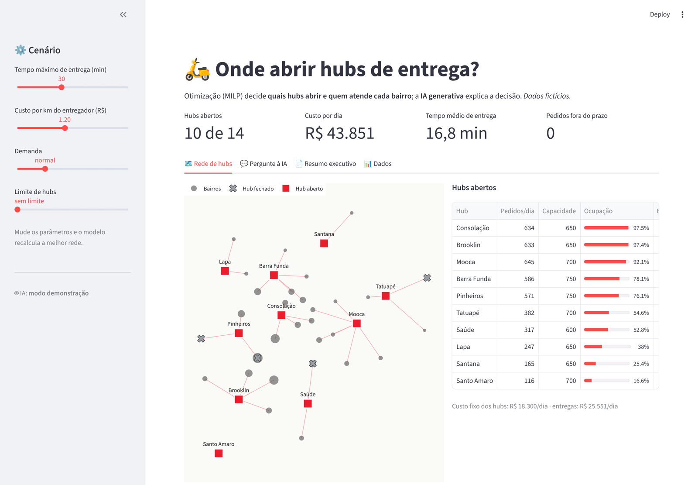
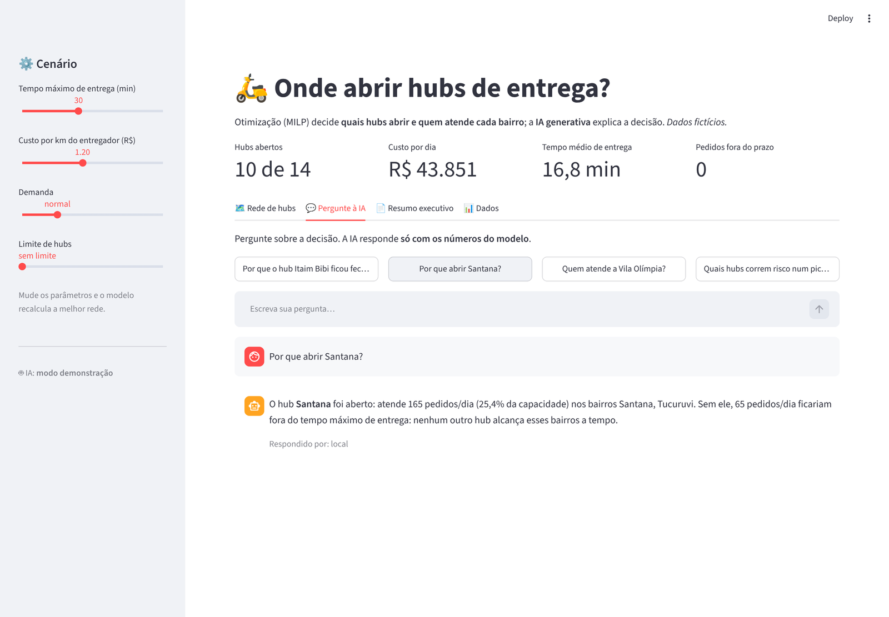
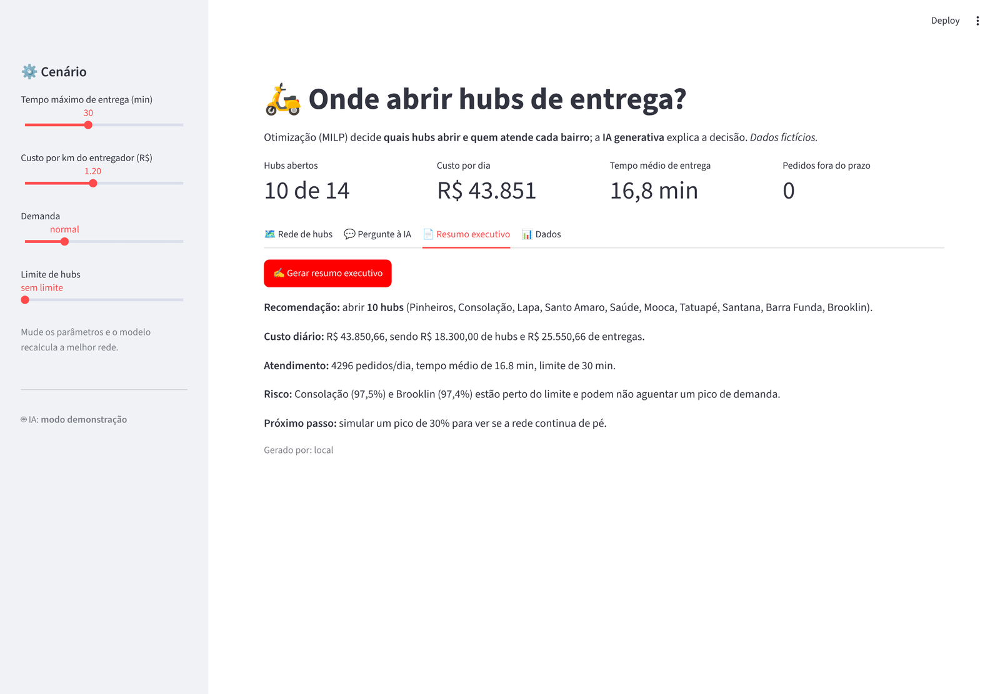

# 🛵 Hubs de Entrega · Otimização + IA Generativa

Onde uma empresa de delivery deveria abrir seus **hubs de entrega** em São Paulo para entregar **rápido** gastando **o mínimo**? E como explicar essa decisão para quem não é técnico?

Este projeto junta duas coisas:
- um **modelo de otimização (MILP)**, que decide quais hubs abrir e qual hub atende cada bairro;
- uma camada de **IA generativa**, que **explica a decisão em linguagem natural** e escreve um resumo executivo.

> ⚠️ Todos os dados são **fictícios**: demanda, custos e capacidades são gerados por `dados/gerar_dados.py`. As coordenadas dos bairros são aproximadas.



## O problema
- **40 bairros** de São Paulo, cada um com uma demanda de pedidos por dia
- **14 imóveis candidatos** a hub, cada um com custo diário e capacidade
- Cada pedido precisa chegar dentro de um **tempo máximo** (ex.: 30 min)

Abrir muitos hubs encurta as entregas, mas aumenta o aluguel. Abrir poucos economiza no aluguel, mas os entregadores rodam mais e alguns bairros ficam fora do prazo. O modelo encontra o melhor equilíbrio.

## O modelo (MILP)
Variáveis:
- `y[j] = 1` se o hub *j* for aberto
- `x[i,j] = 1` se o bairro *i* for atendido pelo hub *j*

Objetivo: **minimizar** o custo fixo dos hubs abertos + o custo de deslocamento (pedidos × km × R$/km, ida e volta).

Restrições:
- todo bairro é atendido por exatamente um hub;
- só hubs abertos atendem;
- só pode atender quem chega **dentro do tempo máximo** (10 min de preparo + deslocamento);
- cada hub respeita sua **capacidade**;
- opcional: limite de quantidade de hubs.

Resolvido com **PuLP** (solver HiGHS ou CBC).

### "E se?" para cada decisão
Depois de resolver, o modelo roda de novo **forçando a decisão contrária** em cada hub (abrir os fechados e fechar os abertos). Assim, cada decisão tem um motivo **calculado**, por exemplo: *"abrir Itaim Bibi aumentaria o custo em R$ 254,83/dia"* ou *"sem Santana, 65 pedidos/dia ficariam fora do prazo"*.

## A IA generativa
A IA **não decide nada**: quem decide é a otimização. A IA recebe o resultado em JSON (com os "e se?") e:
- 💬 **responde perguntas**: *"Por que o hub Itaim Bibi ficou fechado?"*, *"Quais hubs correm risco num pico?"*;
- 📄 **escreve um resumo executivo** para a diretoria.

O prompt obriga a IA a usar **só os números do modelo**, para evitar respostas inventadas. Funciona com **OpenAI** ou **Gemini**; sem chave, o app entra em **modo demonstração** com respostas montadas a partir dos próprios números.

| Pergunte à IA | Resumo executivo |
|---|---|
|  |  |

## Cenários
Na barra lateral dá para mudar o **tempo máximo de entrega**, o **custo por km**, a **demanda** (simular um pico de até 50%) e o **limite de hubs**. O modelo recalcula a rede na hora.

## Como rodar
```bash
pip install -r requirements.txt
python dados/gerar_dados.py      # opcional: os CSVs já estão no repositório
streamlit run app.py
```

Para ligar a IA, copie `.streamlit/secrets.toml.example` para `.streamlit/secrets.toml` e coloque **uma** chave (`OPENAI_API_KEY` ou `GEMINI_API_KEY`). O arquivo de segredos não vai para o GitHub.

## Estrutura
```
app.py                 dashboard (Streamlit)
src/modelo.py          modelo MILP, cenários e "e se?"
src/ia.py              perguntas e resumo com OpenAI / Gemini
dados/gerar_dados.py   gera os dados fictícios
dados/*.csv            bairros e candidatos a hub
```

## Tecnologias
Python · PuLP (MILP) · pandas · Streamlit · Plotly · OpenAI API / Gemini API
